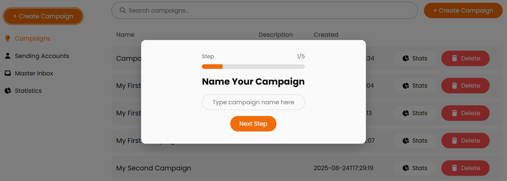
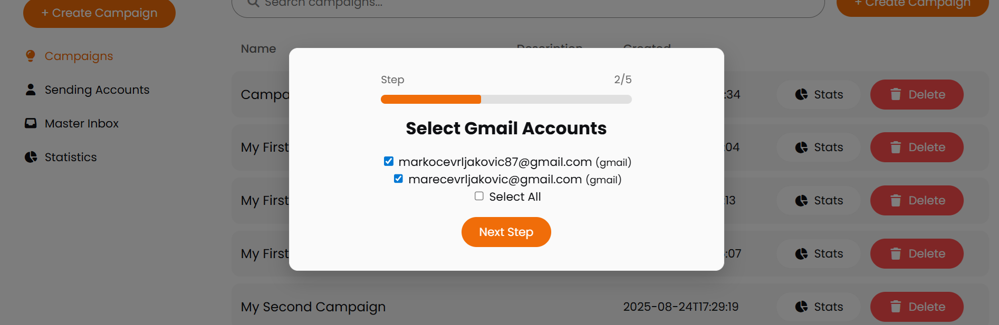
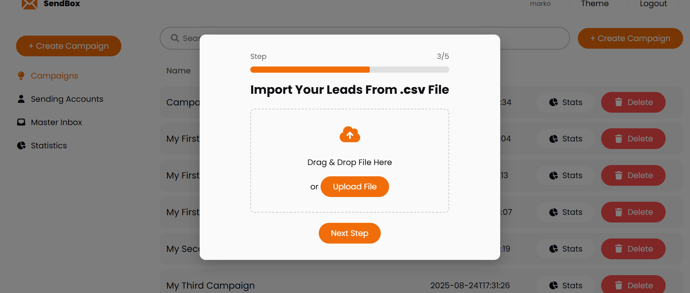
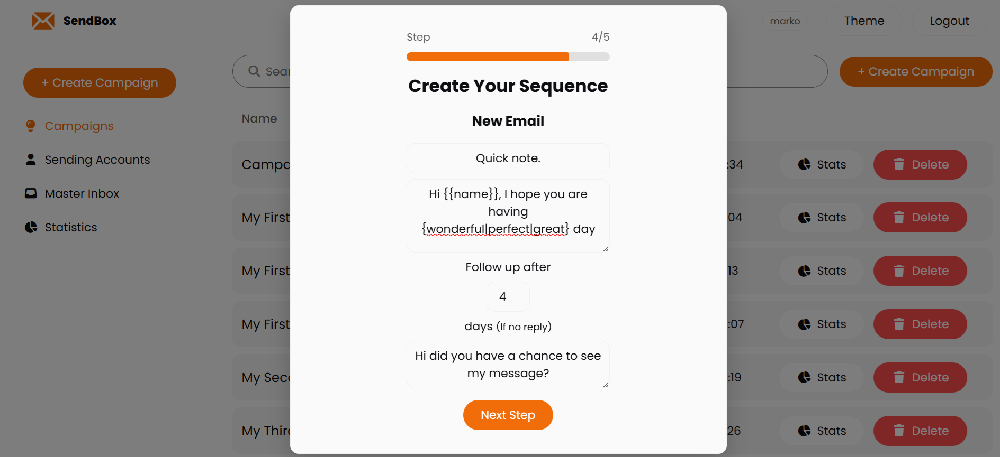
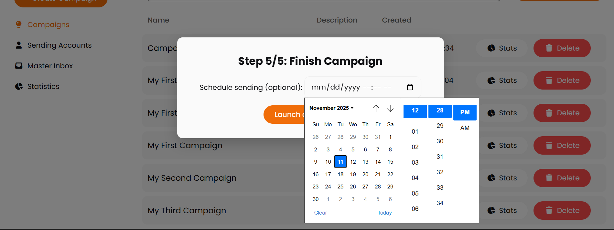
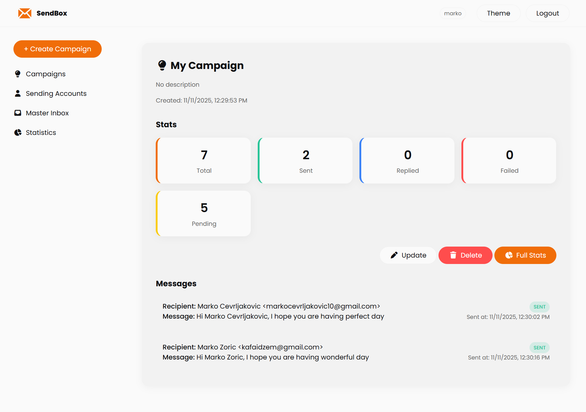
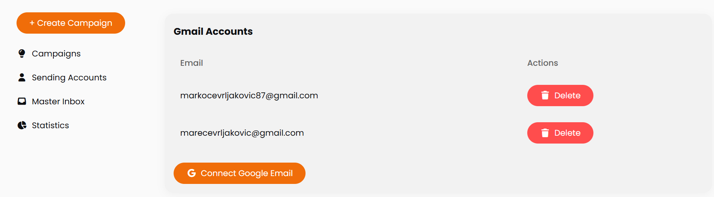
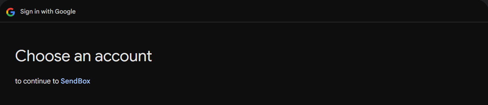

# Cold Email Automation Platform

Multi-tenant cold outreach backend (Spring Boot + MySQL + Redis). Users import lead lists from CSV, write templates with `{{name}}` personalization and spintax, and send through a pool of rotated Gmail / Google Workspace inboxes connected via OAuth2. Sends are scheduled in Redis, run on a worker pool behind per-inbox Lua rate limits, and tracked through to Gmail replies and automatic follow-ups. It is designed to scale throughput by adding inboxes: about 25 Workspace accounts at 2,000/day each gives 50,000+ emails/day (see [Throughput](#throughput) for the limits that currently apply).

[Demo video (Loom)](https://www.loom.com/share/eededfb7860d461fbe931f13155564a0)

---

## Key features

- **Gmail OAuth2 sending accounts.** Uses XOAUTH2 over SMTP, refreshes access tokens automatically and stores tokens encrypted with AES-GCM.
- **Inbox rotation.** Recipients are spread round-robin across the inboxes picked for a campaign.
- **Redis-backed scheduling.** A ZSET holds delayed jobs and a Stream feeds a consumer-group worker. Failed jobs are retried and then moved to a dead-letter stream.
- **Atomic rate limiting in Lua.** Each SMTP account has sliding-window limits per minute, hour and day. Each user has hourly and daily email quotas and a batch-upload quota.
- **CSV bulk import.** Rows are `name,email` and each email is validated with Apache Commons Validator.
- **Personalization.** `{{name}}` substitution plus spintax (`{Hi|Hello|Hey}`), resolved separately for each recipient.
- **Follow-ups.** An hourly cron sends up to 2 follow-ups per message, in order, after a set number of days and only if there was no reply. A DB unique constraint prevents duplicates.
- **Reply sync.** Every 5 minutes the app polls each connected Gmail inbox and matches replies to sent messages via `In-Reply-To`, which marks the original `REPLIED` and cancels its follow-ups.
- **Message lifecycle.** `PENDING → PROCESSING → SENT | FAILED`, then `REPLIED`. Optimistic locking (`@Version`) stops two workers from sending the same message.
- **Campaign analytics.** REST endpoints plus a GraphQL endpoint for per-campaign stats.
- **Auth.** JWT access/refresh tokens, Google login, email verification and password reset.

---

## Architecture

```mermaid
flowchart LR
    CSV["CSV upload<br/>POST /emails/batch"] --> P["CsvParserService<br/>validate name,email"]
    P --> URL{"UserRateLimiter<br/>Lua: batch + hour/day quota"}
    URL -->|exceeded| R400["400 RateLimitExceededException"]
    URL --> C["EmailMessageCreationService<br/>name + spintax<br/>round-robin inbox per recipient"]
    C --> DB[("MySQL<br/>email_messages: PENDING")]
    C --> Z[("Redis ZSET<br/>scheduled_emails<br/>score = send epoch")]

    Z -->|"RedisEmailDispatcher<br/>every 5s: score <= now"| S[("Redis Stream<br/>email_send_queue")]
    S -->|"XREADGROUP count 20<br/>every 1s"| W["EmailStreamWorker"]
    W --> EX["emailTaskExecutor<br/>ThreadPoolTaskExecutor"]
    EX --> L["EmailLockService<br/>PENDING to PROCESSING<br/>optimistic lock"]
    L --> SRL{"SmtpRateLimiter<br/>Lua sliding window<br/>min / hour / day per inbox"}
    SRL -->|over limit| RQ["requeue / retry"]
    SRL --> TM["GmailTokenManager<br/>refresh if expiring within 60s"]
    TM --> SMTP["GmailSmtpSender<br/>XOAUTH2 to smtp.gmail.com:587"]
    SMTP --> ST["EmailStatusService<br/>SENT / FAILED"]
    RQ -->|"retry <= 3"| S
    RQ -->|"retry > 3"| DLQ[("Redis Stream<br/>email_dead_letter_queue")]

    ST --> DB
    GM["ReplyCheckScheduler<br/>every 5 min<br/>Gmail API: is:unread newer_than:1d"] -->|match In-Reply-To| REP["REPLIED + EmailReply"]
    REP --> DB
    FU["FollowUpSchedulerService<br/>cron hourly"] -->|"no reply, delay passed"| Z
```



Package map (`backend/src/main/java/dev/marko/EmailSender/`):

| Concern | Location |
|---|---|
| Scheduling (ZSET → Stream) | `email/schedulers/RedisEmailScheduler`, `RedisEmailDispatcher`, `EmailSchedulingService` |
| Worker / retries / DLQ | `redis/EmailStreamWorker`, `redis/RedisKeys`, `config/AsyncConfig` |
| Send + lock + status | `email/schedulers/EmailSendService`, `EmailLockService`, `EmailStatusService` |
| Rate limiting | `ratelimit/*`, `resources/lua/*.lua` |
| Senders | `email/send/EmailSenderDelegator`, `GmailSmtpSender`, `SmtpEmailSender` |
| OAuth2 / tokens | `email/connection/gmailOAuth/*` |
| Token encryption | `security/AesEncryptor`, `security/EncryptionService` |
| CSV / batch | `email/send/batch/*` |
| Follow-ups | `email/followup/*` |
| Reply sync | `email/reply/*` |
| Tenant scoping | `repositories/base/UserScopedRepository`, `security/CurrentUserProvider` |

---

## Technical decisions

### 1. Redis ZSET + Stream instead of an in-memory scheduler

**Problem:** campaigns are scheduled hours or days ahead. With an in-process `ScheduledExecutorService`, a deploy or crash loses every pending job, and you can't run a second instance.

**Approach:** the job is just the message ID, stored in the ZSET `scheduled_emails` with the send time (epoch seconds) as its score. `RedisEmailDispatcher` moves due IDs into the Stream `email_send_queue` every 5 s. `EmailStreamWorker` reads from that stream through the consumer group `email_send_group` and ACKs only once the job is handled. A failure re-adds the job with `retry+1`. After 3 retries it goes to `email_dead_letter_queue`.

**Why:** the schedule lives in Redis (on the `redis_data` volume), not in the JVM. Message state lives in MySQL, and the lock (`PENDING → PROCESSING` with JPA `@Version`) makes delivery at-least-once without double sends. Any number of workers can share the consumer group.

```java
// RedisEmailDispatcher — promote due jobs from the delay set to the work stream
Set<String> ready = redis.opsForZSet().rangeByScore(
        RedisKeys.SCHEDULED_EMAILS, 0, now);

for (String emailId : ready) {
    redis.opsForZSet().remove(RedisKeys.SCHEDULED_EMAILS, emailId);
    Map<String, String> body = Map.of("emailId", emailId);
    RecordId recordId = redis.opsForStream().add(
            StreamRecords.newRecord().in(RedisKeys.SEND_STREAM).ofMap(body));
}
```

### 2. Lua scripts for atomic sliding-window rate limits

**Problem:** several worker threads, possibly on several instances, send from the same inbox. Gmail punishes bursts. A read-check-write sequence from Java has a race: two threads both see 499/500 and both send.

**Approach:** `smtp_rate_limit.lua` keeps one ZSET per window for each inbox (`rate_limit:smtp:{id}:minute|hour|day`). In one atomic call it trims expired entries, checks every window and records the send only if all three windows pass. User quotas (`rate_limit:user:{id}:hour|day`) use the same pattern. Batch uploads use a fixed-window `INCR`/`EXPIRE` counter.

**Why:** a sliding window has no burst at the window boundary, which a fixed counter allows, and running it in Lua makes check-and-consume a single atomic step. If Redis errors, the limiter fails open and logs the failure, so a Redis problem doesn't stall sending.

```lua
for i, w in ipairs(windows) do
    redis.call('ZREMRANGEBYSCORE', w.key, 0, now - w.window)
    local current = redis.call('ZCARD', w.key)
    if current + count > w.limit then
        return 0
    end
end
-- all windows passed: ZADD the send into each window, then EXPIRE
```

### 3. AES-GCM for OAuth tokens at rest

**Problem:** refresh tokens give full `https://mail.google.com/` access to a user's inbox. A DB dump must not expose them.

**Approach:** `AesEncryptor` uses `AES/GCM/NoPadding` with a random 12-byte IV per value and a 128-bit auth tag. It stores `ENC::` + Base64(IV ‖ ciphertext‖tag). The key is Base64 in `TOKEN_ENCRYPTION_KEY`, and a 32-byte key gives AES-256. Because of the `ENC::` prefix, `encryptIfNeeded` / `decryptIfNeeded` are idempotent and can tell legacy plaintext rows from encrypted ones.

**Why:** GCM is authenticated, so a tampered value fails to decrypt instead of silently producing garbage. A fresh IV per value means equal tokens never produce equal ciphertext.

```java
byte[] iv = new byte[GCM_IV_LENGTH];                                        // 12
new SecureRandom().nextBytes(iv);

Cipher cipher = Cipher.getInstance(ALGORITHM);                              // AES/GCM/NoPadding
GCMParameterSpec parameterSpec = new GCMParameterSpec(GCM_TAG_LENGTH, iv); // 128-bit tag
cipher.init(Cipher.ENCRYPT_MODE, keySpec, parameterSpec);

byte[] encrypted = cipher.doFinal(value.getBytes(StandardCharsets.UTF_8));

byte[] combined = new byte[iv.length + encrypted.length];
System.arraycopy(iv, 0, combined, 0, iv.length);
System.arraycopy(encrypted, 0, combined, iv.length, encrypted.length);

return PREFIX + Base64.getEncoder().encodeToString(combined);
```

### 4. Inbox rotation for deliverability

**Problem:** a single inbox caps out at Google's daily limit (about 2,000 for Workspace) and builds up a spam reputation quickly.

**Approach:** the inbox is assigned when messages are created, not when they are sent. Recipient `i` gets `smtpList.get(i % smtpList.size())`. Messages are spaced `email.scheduling.default-delay-seconds` apart (15 s by default), so with N inboxes each one sends at most every `15·N` s. Follow-ups reuse the original message's inbox so the thread stays in one mailbox and reply sync can find it.

**Why:** assigning upfront is deterministic, keeps the sending account visible in the UI and needs no shared rotation state at send time. The per-inbox Lua limiter is the safety net if several campaigns overlap on the same inbox.

### 5. Multi-tenant scoping in the repository layer

**Problem:** every resource (campaigns, templates, inboxes, messages, replies) belongs to a user. An ID-only lookup is an IDOR waiting to happen.

**Approach:** repositories implement `UserScopedRepository<E>` (`findByIdAndUserId`, `findAllByUserId`), and `BaseService` resolves the current user from `CurrentUserProvider` (the JWT principal) before looking anything up. Batch sends also filter the requested SMTP IDs down to the ones the caller owns.

**Why:** scoping is enforced at query level, so a missing ownership check becomes a 404 instead of a data leak.

---

## Throughput

The pipeline has four limits. The lowest one decides throughput.

| Limit | Where | Value in code |
|---|---|---|
| Per-inbox sending | `RateLimitConfig.SmtpRateLimit` (defaults, no `rate-limit.*` overrides in YAML) | 60 / min, 500 / h, **2,000 / day** |
| Spacing inside a batch | `email.scheduling.default-delay-seconds` | 15 s between consecutive messages (≈ 5,760 / day per batch) |
| Per-user quota | `RateLimitConfig.UserRateLimit` (defaults) | 100 / h, 1,000 / day, 10 batch uploads / h |
| Worker | `EmailStreamWorker` + `app.async.*` | 20 messages read per 1 s poll. Prod pool: core 20 / max 50 / queue 1,000 (default profile: 10 / 20 / 500) |

**How to reach 50,000/day:** you need at least 25 Workspace inboxes in rotation at the per-inbox ceiling (25 × 2,000 = 50,000). That spreads 50k messages over 86,400 s, which needs a batch spacing of about 1.7 s (`default-delay-seconds: 1`, or run several batches in parallel). That puts each inbox at one message every ~43 s, well under 60/min and 500/h. The worker allows up to 20 sends per second (≈ 1.7M/day), so it is not the bottleneck. SMTP latency and the per-inbox limits are.

> With the shipped defaults, the per-user quota (1,000/day, 100/hour) and the 15 s spacing cap a single user well below that. Raise `rate-limit.user.*` and lower `email.scheduling.default-delay-seconds` to unlock the multi-inbox ceiling.

---

## Tech stack

| Layer | Technology |
|---|---|
| Language / runtime | Java 17 (compiler target; CI and the Docker build stage use JDK 24, the runtime image is Temurin 17) |
| Framework | Spring Boot 3.4.5: Web, Security, OAuth2 Client, Data JPA, Data Redis, Mail (Jakarta Mail), GraphQL, Validation, Retry, Actuator |
| Persistence | MySQL 8.0.42, Flyway migrations, Hibernate (JDBC batch size 50) |
| Queue / rate limiting | Redis 7 (ZSET, Streams, Lua scripts) via Lettuce |
| Google | Gmail API v1 client (reply sync, profile), OAuth2 token endpoint over `RestTemplate`, XOAUTH2 SMTP |
| Auth | JJWT 0.12.6, BCrypt, Google login |
| Mapping / boilerplate | MapStruct 1.6, Lombok |
| Frontend | Vanilla JS, Vite 5, axios, TanStack Query core, page.js, yup |
| Infra | Docker (multi-stage builds), Docker Compose (MySQL, Redis, backend, frontend, Nginx reverse proxy), GitHub Actions |
| Tests | JUnit 5, Mockito, Spring Boot Test, H2 |

---

## Running locally

### Option A: full stack with Docker Compose

Compose pulls the prebuilt images `cevrljakovic/email-backend` and `cevrljakovic/email-frontend` and runs the backend with `SPRING_PROFILES_ACTIVE=prod`. Nginx serves everything on port 80: `/api/*` goes to the backend and `/` to the frontend.

```bash
git clone https://github.com/markocevrljakovic/cold-email-sending-app.git
cd cold-email-sending-app/backend
cp .env.example .env        # fill in the values below
docker compose up -d
# http://localhost
```

To build the images from source instead of pulling them:

```bash
docker build -t cevrljakovic/email-backend  ./backend
docker build -t cevrljakovic/email-frontend ./frontend
```

### Option B: backend from source

Start MySQL on `localhost:3306` and Redis on `localhost:6379`, then:

```bash
cd backend
./mvnw spring-boot:run -Dspring-boot.run.profiles=dev
```

The `dev` profile switches the datasource and Redis host to `localhost`. Env vars are read from `backend/.env` (via `spring-dotenv`) or from the shell.

### Environment variables (`backend/.env`)

| Variable | Used for |
|---|---|
| `DB_PASSWORD` | MySQL root password (container and datasource) |
| `DB_NAME`, `DB_HOST`, `DB_USERNAME` | prod datasource (defaults `email_sender`, `mysql`, `root`) |
| `REDIS_HOST` | prod Redis host (default `redis`) |
| `JWT_SECRET_KEY` | JWT signing key |
| `TOKEN_ENCRYPTION_KEY` | Base64 AES key for OAuth tokens. Use 32 bytes for AES-256 (`openssl rand -base64 32`) |
| `GOOGLE_CLIENT_ID`, `GOOGLE_CLIENT_SECRET` | "Sign in with Google" (redirect `${APP_URL}/login/oauth2/code/google`) |
| `GMAIL_CLIENT_ID`, `GMAIL_CLIENT_SECRET` | Gmail sending-account OAuth (scope `https://mail.google.com/`, redirect `${FRONTEND_URL}/oauth2callback`) |
| `CONFIRMATION_EMAIL`, `EMAIL_SECRET_APP_PASSWORD` | Gmail account plus app password for verification and password-reset mail |
| `APP_URL`, `FRONTEND_URL`, `FRONTEND_LOGIN` | Public backend/frontend URLs used in redirects and email links |

### CSV format

```csv
name,email
Marko,marko@example.com
```

Exactly two columns, with a header row. Only the first word of `name` is used for `{{name}}`.

---

## Screenshots

### Campaign wizard


1. Name the campaign.


2. Select sending accounts, either all of them or a subset. Recipients are rotated across the selected inboxes.


3. Upload the CSV lead list (`name,email`).


4. Write the subject, body and follow-up, using `{{name}}` and spintax such as `{great|good|wonderful}`.


5. Pick the launch date and time (in the campaign's timezone).


6. Per-campaign analytics: every message with its time, status and body.

### Connecting a sending account (Google OAuth2)


1. On **Sending accounts**, click *Connect Google email* (Gmail or Google Workspace).


2. Pick the Google account to authorize.

---

## Testing

```bash
cd backend
./mvnw verify
```

GitHub Actions (`.github/workflows/test.yml`) runs `mvn --batch-mode --update-snapshots verify` on JDK 24 on every push. Tests run with the `test` profile against in-memory H2 with Flyway disabled. No MySQL or Redis is needed.

There are 75 tests across 19 classes, mostly Mockito unit tests on the service layer:

| Area | Tests |
|---|---|
| Follow-ups: eligibility (reply cancels, delay not passed, ordering, max count, already sent), creation, query, scheduler | 17 |
| Sending: batch flow, message creation and rotation, scheduling, CSV parsing, spintax/personalization, message service | 16 |
| Gmail OAuth: token manager refresh / `invalid_grant` revocation, token exchange, connection | 13 |
| CRUD services: campaigns, templates, SMTP accounts | 22 |
| Replies, password reset, context load | 7 |

Not covered yet: the Redis worker and dispatcher, the Lua rate limiters, and `AesEncryptor`.
